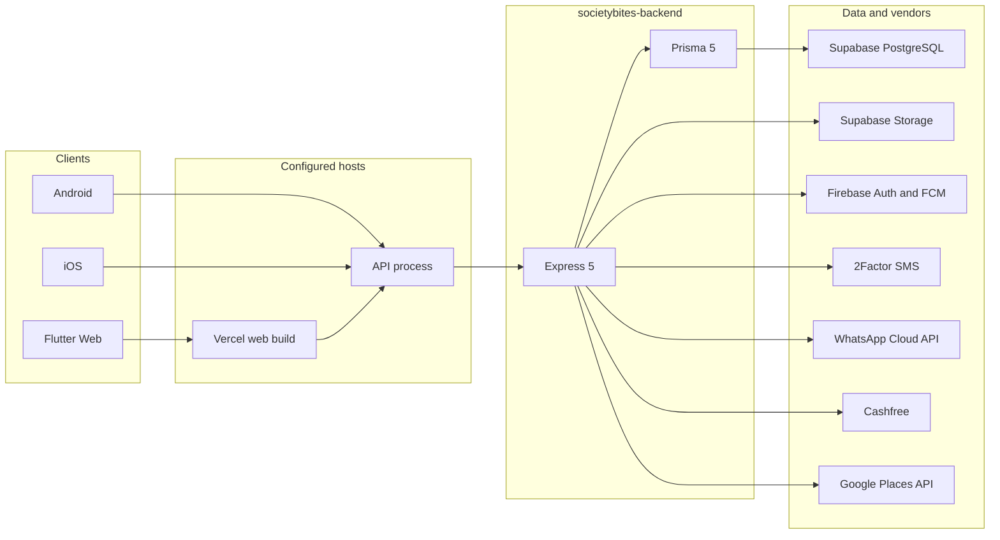
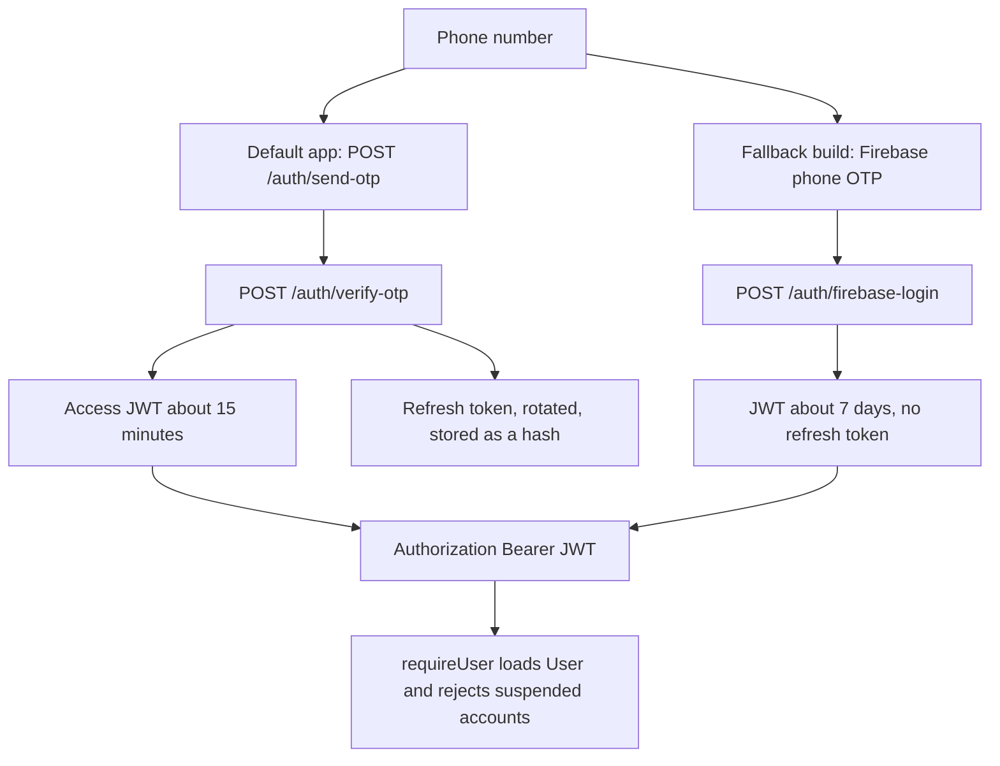
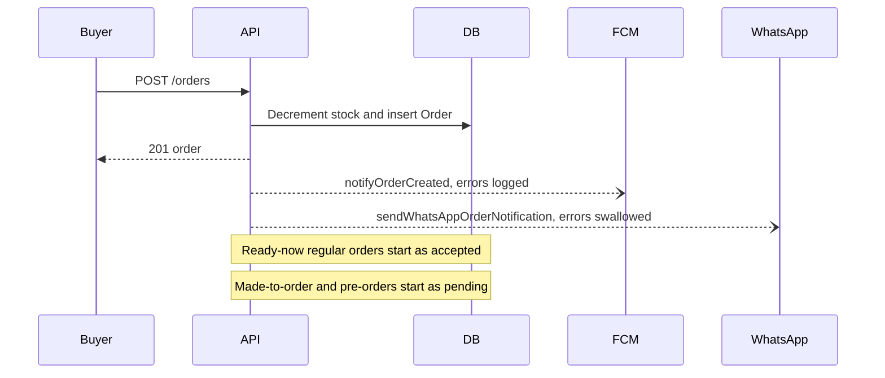
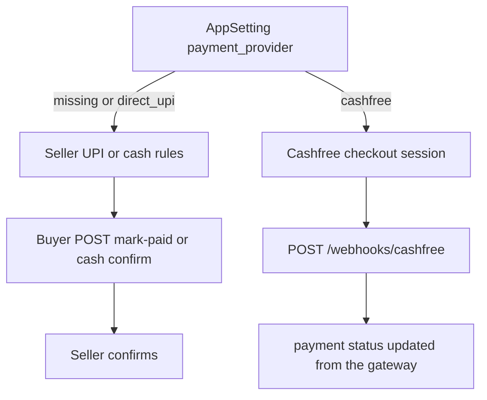

# SocietyEats architecture

Verified from source on 15 November 2026. Deployment hosts are described as what the repo configures. Live traffic was not probed.

## System shape

The Flutter app talks to one HTTP API. There is no separate WhatsApp process. WhatsApp is a library call that cannot fail the order. There is no separate payments service. Payments are routes plus `societybites-backend/lib/payments/`.

## Technology stack

| Layer | What the repo uses | Notes |
|---|---|---|
| App | Flutter and Dart, SDK `^3.11.4` | `pubspec.yaml`. Web, Android, and iOS projects are present. Windows and Linux runners also exist from the Flutter template |
| Web deploy | Vercel | `vercel.json`, `scripts/vercel_build.sh` pins Flutter `3.44.0` |
| API | Node.js, Express `^5.2.1` | CI uses Node 20. Entry `societybites-backend/index.js` |
| ORM | Prisma `^5.22.0` | Schema `societybites-backend/prisma/schema.prisma` |
| Database | PostgreSQL | Env comments say Supabase. Runtime URL is `DATABASE_URL`. Migrations use `DIRECT_URL` |
| Auth | 2Factor SMS by default, Firebase phone auth as a build fallback | Both issue a backend JWT |
| Push | Firebase Cloud Messaging via `firebase-admin` | Device tokens in `DeviceToken` |
| Images | Supabase Storage bucket `listing-images` when configured | Otherwise the server logs that listing images are not configured. Local `/uploads` is still served |
| Maps discovery | Google Places API (New), server-side only | `GOOGLE_PLACES_API_KEY` |
| WhatsApp | Meta Cloud API | Optional |
| Gateway | Cashfree, optional | Default provider is direct UPI |
| Tests | `flutter test`, Node test scripts, GitHub Actions | `.github/workflows/regression.yml` |

`cloud_firestore` is in `pubspec.yaml`. No Dart file under `lib/` references `FirebaseFirestore`. Treat Firestore as an unused dependency, not as an active data store.

Not present in code: Twilio, Razorpay, PayU, Docker, a Render blueprint, a DigitalOcean app spec. Razorpay and PayU appear only as examples of rejected provider names in `societybites-backend/tests/payment-provider.test.js`.

## Frontend architecture

The app starts in `lib/main.dart`.

- Web uses path URLs. If the host or path is a kitchen site, `SellerKitchenSiteScreen` opens before the normal auth gate.
- Otherwise `AuthGate` restores a session and shows `MainShellScreen`, society selection, or the signed-out start screen.
- `MainShellScreen` is the buyer and seller shell: Home, Orders, Seller dashboard, Profile. State is widget state plus `SessionService`, `CartController`, and small caches. There is no Redux or Riverpod dependency.
- Admin UI lives under `lib/screens/admin/` and opens as `AdminShellScreen`.
- HTTP is centralized in `lib/services/api_service.dart`. `API_BASE_URL` is a compile-time `--dart-define`. The default in source is `https://societyeats-42ird.ondigitalocean.app`.
- Auth provider is a compile-time `--dart-define=AUTH_PROVIDER`. Default is `2factor` (`lib/services/auth_config.dart`).

Important Flutter areas:

| Area | Location |
|---|---|
| Screens | `lib/screens/` |
| Admin | `lib/screens/admin/` and `lib/admin/` |
| Widgets | `lib/widgets/` |
| Web layout | `lib/web/` |
| API and session | `lib/services/api_service.dart`, `lib/services/session_service.dart` |
| Direct UPI launch | `lib/services/upi_payment_service.dart` |
| Kitchen host detection | `lib/services/storefront_host.dart` |

## Backend architecture

`societybites-backend/index.js` creates the Express app, serves `/uploads` and `/seed-images`, and mounts routers. `npm start` runs `scripts/ensure-db-migrations.js` and then the server. `npm run dev` watches `index.js` and does not run that migrate step.

Business rules sit in `societybites-backend/lib/`. Route files should call those modules. Shared HTTP helpers are `utils/asyncHandler.js`, `utils/listingSerializer.js`, and `utils/notifications.js`.

Request logs omit `/health` and `/ready`. JSON body limit is 8mb. Cashfree webhook raw body is kept only for paths starting with `/webhooks/cashfree`.

Global error behavior:

- Prisma `P2002` returns 409 `Record already exists`.
- Prisma `P2025` returns 404 `Record not found`.
- A stale Prisma client returns 503 with code `PRISMA_CLIENT_STALE`.
- Status 500 is replaced with `Internal server error`.
- Other `err.statusCode` values return `err.message`.

CORS is `app.use(cors())` with no origin allow-list. Security headers set `X-Content-Type-Options`, `X-Frame-Options`, and `X-XSS-Protection`.

## Database architecture

PostgreSQL through Prisma. The runtime connection is expected to be the Supabase transaction pooler (`pgbouncer=true`), and Prisma CLI is expected to use `DIRECT_URL`. See [DATABASE_REFERENCE.md](DATABASE_REFERENCE.md).

Most lifecycle fields are strings, not Prisma enums. Coupon fields are the exception and use Prisma enums. Changing a string status is an application change in the route or library that interprets it, plus a data migration if old rows must move.

`AppSetting` is the key-value store for platform fee, payment provider, WhatsApp toggle, serving cities, FSSAI enforcement, force-update builds, and the last marketing push time.

## Authentication

`requireUser` (`societybites-backend/middleware/requireUser.js`) verifies the JWT with `JWT_SECRET` and loads `User` by `payload.userId`. The phone number inside a Firebase token is verified by Firebase Admin. 2Factor verifies the OTP with 2Factor and then finds or creates the user by the normalized phone. The API does not accept a client-supplied user id as identity.

2Factor challenges live in process memory (`lib/otpStore.js`). A restart, or a second instance, drops them. Refresh tokens are rows in `RefreshToken`.

`signAccessToken` is the 15-minute token used by verify and refresh. `POST /auth/me/profile-photo`, `POST /auth/me/seller-terms`, and `PATCH /auth/me/profile` answer with `signToken` instead, which uses `JWT_EXPIRY` (default 7 days). A 2Factor user who updates a profile therefore receives a long-lived access token.

If `JWT_SECRET` is unset, `lib/jwt.js` falls back to a hardcoded development secret. Production must set `JWT_SECRET`. See [KNOWN_ISSUES.md](KNOWN_ISSUES.md).

Test phones and a fixed OTP exist behind `TEST_OTP_ENABLED`. The bypass stays off unless that flag is true. Do not enable it for real customers.

`docs/2FACTOR_AUTH_CHECKPOINT.md` says Firebase was still the default and that 2Factor was not the live path. That checkpoint is stale. `lib/services/auth_config.dart` now defaults to 2Factor. Which binary is installed on a given phone was not verified.

## Authorization

| Check | Rule |
|---|---|
| `requireJoinedSociety` | Buyer features that need a feed require `User.societyId` |
| Seller mutations | Listing and order seller actions compare the JWT user with `listing.sellerId` or the order's item sellers |
| Buyer mutations | Order cancel and pay actions compare the JWT user with `order.buyerId` |
| Admin read | `super_admin`, `consoleAdmin`, or legacy `role = admin` |
| Admin write | `super_admin` only. Enforced by a router-level check: non-GET `/admin` calls `requireSuperAdmin` |
| Saved places | Buyers, and admin roles, may use them. Sellers receive 403 |
| Staff | `SellerStaffMembership` role `owner` can view a kitchen. The schema mentions `manager`, and comments say there is no revoke API |

## API structure

Routers are mounted in `index.js`:

| Prefix | File |
|---|---|
| `/auth` | `routes/auth.js` plus buyer addresses and kitchen moves under `/auth/me` |
| `/societies` | `routes/societies.js` |
| `/listings` | `routes/listings.js` |
| `/preorder-campaigns` | `routes/preorderCampaigns.js` |
| `/orders` | `routes/orders.js` |
| `/payments` | `routes/payments.js` |
| `/webhooks` | `routes/paymentWebhooks.js` |
| `/reviews` | `routes/reviews.js` |
| `/media` | `routes/media.js` |
| `/admin` | `routes/admin.js` |
| `/settings` | `routes/settings.js` |
| `/devices` | `routes/devices.js` |
| `/issues` | `routes/issues.js` |
| `/coupons` | `routes/coupons.js` |
| `/fssai` | `routes/fssai.js` |
| `/seller-staff` | `routes/sellerStaff.js` |
| `/festival-banners` | `routes/festivalBanners.js` |
| `/public` | `routes/public.js` |

`/auth` is rate-limited to 20 requests per minute per IP, in memory. OTP send has a tighter limiter. Places search is limited to 30 per minute. Other routes are not globally rate-limited. The full route list is [API_REFERENCE.md](API_REFERENCE.md).

## Order data flow

Status values that can still be assigned: `pending`, `accepted`, `ready`, `completed`, `cancelled`, `rejected`.

Transitions in `routes/orders.js`:

| From | Allowed patch targets |
|---|---|
| `pending` | `accepted`, `cancelled` |
| `accepted` | `ready`, `cancelled` |
| `preparing` | `ready` (legacy rows only) |
| `ready` | `completed` |
| `picked_up` | `completed` (legacy rows only) |

`preparing` and `picked_up` cannot be assigned. Rejection uses `POST /orders/:id/reject`, not the status patch. Seller actions are `accepted`, `ready`, and `completed`. The buyer action on the patch is `cancelled`.

Ready-now regular orders skip the seller accept step and are inserted as `accepted`. Made-to-order and pre-orders stay `pending` until the seller accepts. UPI orders that `upiBlocksPreparation` cannot move to `ready` until the buyer has marked paid. Completion checks `assertCanCompleteOrder`. Cancelling or rejecting restores reserved inventory.

`POST /payments/:orderId/confirm-delivery-cash` can set `completed` when the order is an outside-society UPI food plus cash delivery fee order, the order is `ready` or legacy `picked_up`, and completion checks pass.

## Notifications

`utils/notifications.js` sends FCM through Firebase Admin and records failures in logs. Call sites use `void flushNotification(...)`, so the HTTP response is not tied to push delivery.

`lib/whatsappCloud.js` sends Meta template messages. `sendWhatsAppOrderNotification` never rejects. It skips the send when the admin toggle is off, `WHATSAPP_ENABLED` is an emergency off, credentials are missing, or the seller phone is unusable. The admin toggle is `AppSetting.whatsapp_order_notifications`. Missing row means off (`lib/whatsappSetting.js` is the source of that default; do not assume a production row exists).

Idempotent replay of an order does not send another WhatsApp message.

## Payment architecture

`getPaymentProvider()` returns `direct_upi` when the setting is missing. Allowed values are `direct_upi` and `cashfree`. Any other stored value is normalized back to `direct_upi` on read. Checkout writes `Order.paymentProvider` and later setting changes do not rewrite it.

Direct UPI uses the seller's `upiId`. Buyers are not sent an in-app UPI intent for either `PERSONAL` or `MERCHANT` account types, because the comment on `User.upiAccountType` says neither type is an NPCI-verified merchant flag. The app can still build a UPI URI or QR (`lib/services/upi_payment_service.dart`, `qr_flutter`).

Seller payment preference controls new checkouts: `UPI_ONLY`, `UPI_AND_COD`, or `COD_IN_SOCIETY_UPI_OUTSIDE` (the column default).

Cashfree code creates a UPI session, stores a seller vendor on `SellerPayoutProfile`, and verifies webhook signatures. Manual mark-paid and seller confirm are rejected for orders already locked to Cashfree.

The platform fee is `AppSetting` key `platform_fee`, cached for 60 seconds and stored on the order as `communityFee`. Default is 0. `city_platform_fees` is a JSON map of city key to amount. `POST /orders` uses the society's city override when present. `GET /settings` stays global. `GET /settings/platform-fee` is the buyer-facing effective fee. See [LATEST_HANDOVER.md](LATEST_HANDOVER.md).

## Integrations

| Integration | Active in code | Failure behavior |
|---|---|---|
| Supabase Postgres | Required for the API | `/ready` returns 503 |
| Supabase Storage | Required for new listing images when the product expects uploads | Server starts and logs that images are not configured |
| Firebase Admin | Required for Firebase login and FCM | Firebase login fails without credentials. FCM errors are logged |
| 2Factor | Required for the default app build | OTP send fails closed |
| Google Places | Required for live society discovery | Database society search still exists beside it |
| WhatsApp Cloud API | Optional, default off | Skipped or logged. Order still succeeds |
| Cashfree | Optional, default direct UPI | Used only when the setting and the order say so |

## Infrastructure and deployment

| Piece | Evidence | Confidence |
|---|---|---|
| Git remote | `https://github.com/agrawalpuran/societybites.git`, branch `main` | Verified locally |
| Flutter web | `vercel.json` builds `build/web` with `scripts/vercel_build.sh`. SPA rewrite to `index.html`. One host redirect for `puran.societyeats.com` to `/kitchen/puran` | Config verified. Live Vercel project was not opened |
| API default used by the app | DigitalOcean app URL in `ApiService.baseUrl` | The URL is in source. Uptime was not checked |
| API env comments | `societybites-backend/.env.example` tells the operator to set the same variables on Render | Render is documented as an intended or previous host. No Render file is in the repo. Whether Render still serves traffic was not verified |
| Database | Supabase Postgres, pooler plus direct URL | From `.env.example` and Prisma datasource. The live project ref was not copied here |
| CI | GitHub Actions on pull request, push to `main`, nightly schedule, and manual run | Flutter tests and backend unit tests always. API regression only when `CI_DATABASE_URL` is set |
| Migrations on boot | `npm start` runs `scripts/ensure-db-migrations.js` unless `SKIP_DB_MIGRATE=true` | Code verified |

Do not add a new host, a new database, or a new paid API as part of ordinary feature work.
