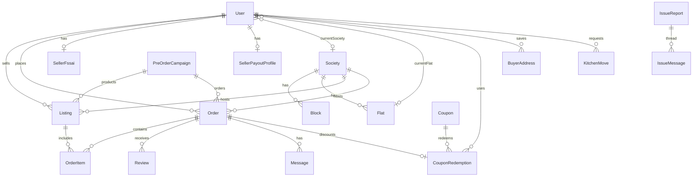

# Database reference

Source: `societybites-backend/prisma/schema.prisma`, read 15 November 2026. PostgreSQL via Prisma. Connection env names are `DATABASE_URL` (runtime, pooler) and `DIRECT_URL` (Prisma CLI).

Status and mode columns are strings unless this page calls them a Prisma enum. Allowed values below are the ones named in schema comments or in the application code that writes them. A string column can still contain older values.

## Diagram

`ListingLike.listingId` is not a foreign key. `Block` is not linked to `Flat`. `Flat.block` is a string.

## Enums

| Enum | Values |
|---|---|
| `CouponDiscountType` | `FIXED`, `PERCENTAGE` |
| `CouponAudienceType` | `ALL`, `SELECTED_USERS` |
| `CouponStatus` | `DRAFT`, `ACTIVE`, `PAUSED`, `EXPIRED`, `EXHAUSTED` |
| `CouponFundedBy` | `SOCIETYEATS` |
| `CouponUsageFrequency` | `ONCE`, `DAILY`, `WEEKLY`, `MONTHLY`, `CUSTOM` |
| `CouponRedemptionStatus` | `APPLIED`, `REDEEMED`, `REVERSED` |

## AppSetting keys

These are rows in `AppSetting`, not columns.

| Key | Purpose | Default when missing |
|---|---|---|
| `platform_fee` | Global fee stored on new orders as `communityFee` when no city override applies | `0` |
| `city_platform_fees` | JSON object of lowercase city key to a fee rounded to two decimals. Missing key falls back to `platform_fee`. Negative values are dropped. Not a Prisma column | none |
| `payment_provider` | `direct_upi` or `cashfree` | `direct_upi` |
| `whatsapp_order_notifications` | Admin toggle | off |
| `serving_cities` | JSON list of active city keys | launch-city code default |
| `fssai_selling_requirement` | `on` or `off` | off |
| `min_ios_build`, `min_android_build` | Force update | `0` |
| `ios_update_url`, `android_update_url` | Store links | empty |
| `marketing_push_last_sent_at` | Last marketing push time | none |

## Models

### User

Identity, seller kitchen settings, and the buyer's current society.

| Field | Type | Notes |
|---|---|---|
| `id` | String uuid | Primary key |
| `phone` | String | Unique |
| `name` | String? | |
| `role` | String | Default `buyer`. Also `seller`, `super_admin`, legacy `admin` |
| `profilePhotoUrl` | String? | |
| `upiId`, `upiDisplayName` | String? | Direct UPI |
| `upiAccountType` | String | Default `PERSONAL`. Also `MERCHANT`. The current app does not collect or display this. The column stays so older builds can still save it |
| `paymentEnabled` | Boolean | Default false |
| `sellingReachLevel` | String | Default `MY_SOCIETY`. Also `BEYOND_SOCIETY`. Legacy `NEARBY`, `EXTENDED` |
| `sellingReachRadiusKm` | Float? | Used when reach is beyond the society |
| `fulfilmentMode` | String | Default `BUYER_PICKUP`. Also `SELLER_DELIVERY`, `BOTH` |
| `deliveryCharge` | Float | Legacy. Default 0 |
| `deliveryChargeInSociety`, `deliveryChargeNearby`, `deliveryChargeExtended` | Float | Default 0 |
| `paymentPreference` | String | Default `COD_IN_SOCIETY_UPI_OUTSIDE`. Also `UPI_ONLY`, `UPI_AND_COD` |
| `outsideDeliveryCollectBy` | String | Default `seller`. Also `delivery_person` |
| `kitchenOpensAt`, `kitchenClosesAt` | String? | `HH:mm` IST. Both null means always open |
| `fssaiNumber`, `fssaiExpiry`, `fssaiRegisteredName` | | Capture fields. Review workflow is `SellerFssai` |
| `addressProofUrl`, `addressProofStatus`, `addressProofReviewedAt`, `addressProofReviewedBy` | | Status `PENDING`, `OK`, `FOLLOW_UP` |
| `suspended` | Boolean | Default false. `requireUser` returns 403 |
| `hideFlatNumber` | Boolean | Default false |
| `consoleAdmin` | Boolean | View-only admin portal |
| `storefrontSlug` | String? | Unique. Public kitchen link |
| `storefrontAccentColor`, `storefrontBannerUrl`, `storefrontTagline` | | Branding |
| `createdAt` | DateTime | |
| `societyId`, `flatId` | String? | Current society and flat. Not a unique "lifetime society" |

Relations: society, flat, listings, orders as buyer, reviews, messages, device tokens, refresh tokens, coupons, FSSAI, staff memberships, payout profile, buyer addresses, kitchen moves, audit logs.

### SellerStaffMembership

| Field | Type | Notes |
|---|---|---|
| `id` | String | |
| `sellerUserId` | String | Kitchen principal. Cascade delete |
| `staffUserId` | String | Invited user. Cascade delete |
| `role` | String | Default `owner`. Comment also names `manager` |
| `status` | String | Default `active`. Comment names `invited`, `active`, `revoked` |
| `createdAt`, `updatedAt` | DateTime | |

Unique `(sellerUserId, staffUserId)`. Indexes on `(staffUserId, status)` and `(sellerUserId, status)`.

### SellerFssai

One row per seller. `userId` unique. Status `NOT_SUBMITTED`, `UNDER_REVIEW`, `APPROVED`, `REJECTED`. `documentStorageReference` is a private storage path. `detailsDeferred` lets a seller skip details while the selling requirement is off. Index `(status, submittedAt)`.

### FssaiAssistanceRequest

Help request. Status `NEW`, `CONTACTED`, `IN_PROGRESS`, `COMPLETED`. Indexes `(status, requestedAt)` and `(userId, requestedAt)`.

### SellerTermsAcceptance

`userId`, `termsVersion`, server-set `acceptedAt`. Unique `(userId, termsVersion)`.

### Society

| Field | Type | Notes |
|---|---|---|
| `id` | String | |
| `name`, `city` | String | |
| `inviteCode` | String | Unique |
| `address`, `state`, `pincode`, `logoUrl` | String? | |
| `status` | String | Default `active` |
| `unitLabel` | String | Default `Block` |
| `googlePlaceId` | String? | Unique. Discovery only |
| `latitude`, `longitude` | Float? | Society location, not live GPS |

### Block

`id`, `name`, `societyId`. No unique constraint on name inside a society is declared in the schema. Flats do not reference `Block`.

### Flat

`id`, `flatNumber`, `block` (string), `floor`, `unit`, `societyId`. Unique `(societyId, flatNumber)`.

### KitchenMove

Request to move a kitchen. Status `PENDING`, `APPROVED`, `REJECTED`, `CANCELLED`. Address proof and a separate FSSAI snapshot stay on this row until approval. Indexes `(status, createdAt)` and `(userId, status)`. `toFlat` uses `onDelete: SetNull`.

### BuyerAddress

Saved buyer place. `selected` marks the place copied onto `User`. Index `(userId, selected)`. Sellers are blocked in application code.

### Listing

| Field | Type | Notes |
|---|---|---|
| `id` | String | |
| `sellerId`, `societyId` | String | |
| `name` | String | |
| `description` | String? | |
| `price` | Float | Regular price |
| `quantity` | Int | Default 1. Remaining portions |
| `weightUnit`, `weightValue` | String? | |
| `variantGroupId`, `variantLabel` | String? | |
| `variantInventoryMode` | String? | `SEPARATE` or `SHARED` |
| `portionUnits` | Int? | Shared pool consumption |
| `tags` | String[] | |
| `foodType` | String? | `VEG` or `NON_VEG` |
| `category` | String? | |
| `categories` | String[] | |
| `availableAt` | DateTime? | Available-until |
| `pickupLocation` | String | Default `My Home (Verified)` |
| `imageUrl` | String? | |
| `status` | String | Default `active`. Application also uses `draft`, `paused`, `expired`, `sold_out`, `inactive`. New `POST /listings` starts as `draft` |
| `featured` | Boolean | |
| `displayOrder` | Int? | |
| `catalogType` | String | Default `REGULAR`. Also `PREORDER` |
| `availabilityMode` | String | Default `READY_NOW`. Also `MADE_TO_ORDER` |
| `preparationTimeMinutes`, `maxDailyOrders` | Int? | |
| `recurringEnabled` | Boolean | |
| `recurringWeekdays` | Int[] | 1 Monday through 7 Sunday |
| `recurringStartMinute`, `recurringEndMinute`, `recurringDailyLimit` | Int? | |
| `campaignId` | String? | Set when the row is a campaign product. Cascade delete with campaign |
| `sourceListingId` | String? | Catalog row this product was copied from. Set null on source delete |
| `inventoryMode` | String? | `demand` or `limited` for campaign products |
| `discountEnabled`, `discountPercent`, `discountStartsAt`, `discountEndsAt` | | Sale layer. Does not overwrite `price` |
| `createdAt`, `updatedAt` | DateTime | |

Indexes: `(societyId, status)`, `sellerId`, `campaignId`, `sourceListingId`, `variantGroupId`.

### ListingLike

`userId`, `dishKey`, `listingId`, `createdAt`. Unique `(userId, dishKey)`. `listingId` is not a foreign key.

### PreOrderCampaign

`sellerId`, `societyId`, `title`, optional description, cover, and fulfilment notes. `orderOpenAt`, `orderCutoffAt`, `fulfilmentAt`. Status `draft`, `open`, `closed`, `cancelled`. `offeredFulfilmentMethods` defaults to `["pickup"]` and may include `seller_delivery`. `defaultDeliveryCharge` defaults to 0. Indexes `(societyId, status)` and `sellerId`.

### Order

| Field | Type | Notes |
|---|---|---|
| `id` | String | |
| `orderNumber` | String | Unique |
| `buyerId`, `societyId` | String | |
| `type` | String | Default `regular`. Also `pre_order` |
| `campaignId` | String? | |
| `fulfilmentMethod` | String? | `pickup` or `seller_delivery`. Null on regular orders per schema comment |
| `deliveryCharge` | Float | Default 0 |
| `deliveryCollectBy` | String? | `seller` or `delivery_person` |
| `deliveryCashConfirmedAt` | DateTime? | |
| `fulfilmentNotes`, `fulfilmentAt` | | Snapshot from campaign |
| `status` | String | Default `pending`. See architecture for transitions |
| `paymentMethod` | String | Default `upi`. Also `cash` |
| `subtotal`, `communityFee`, `total` | Float | `communityFee` is the platform fee snapshot |
| timestamps | DateTime? | `acceptedAt`, `preparingAt`, `readyAt`, `expectedReadyAt`, `requestedReadyAt`, `pickedUpAt`, `completedAt`, `cancelledAt` |
| `paymentStatus` | String | Default `pending` |
| `paymentProvider` | String? | Null until checkout. `direct_upi` or `cashfree` |
| `deliveryProvider` | String? | Null = today's seller delivery. `prorouting` when the POC lock matched at create |
| `gatewayAmount`, `gatewayPaymentId`, `gatewayUpiLink`, `gatewayQrPayload` | | Cashfree session |
| `splitStatus` | String? | `pending`, `created`, `failed`, `not_required` |
| `splitError` | String? | |
| `buyerMarkedPaidAt`, `sellerConfirmedPaidAt`, `lastPaymentReminderAt` | DateTime? | |
| `upiTransactionRef` | String? | |
| `rejectReason`, `rejectedAt`, `rejectedBy` | | |
| `cancelReason` | String? | |

Indexes: `(buyerId, createdAt)`, `(societyId, status)`, `campaignId`, `type`.

### DeliveryTask

Partner rider row. `Order.status` does not change for rider progress. Missing when the kill switch did not lock the order.

| Field | Type | Notes |
|---|---|---|
| `orderId` | String unique | FK to Order, cascade delete |
| `provider` | String | `prorouting` |
| `state` | String | `quoted` through `delivered`, plus `retrying`, `cancelled`, `rto`, `failed`, `seller_fallback` |
| `externalId` | String? | Prorouting order id |
| `retryCount` | Int | Auto re-book at most once |
| `bookedAt` | DateTime? | First successful `createasync` |
| rider / OTP / tracking / fares | | Optional until a webhook fills them |

### OrderItem

`orderId` cascade delete, `listingId`, `quantity`, `unitPrice`, optional `originalUnitPrice` and `discountPercent`. Indexes `orderId`, `listingId`.

### OrderIdempotency

Unique `(buyerId, idempotencyKey)`. `orderId` unique and nullable. Status `PENDING`, `COMPLETED`, `FAILED`.

### Review

`orderId`, `listingId`, `reviewerId`, `rating`, optional `comment`, `tags`, `wouldOrderAgain` default true, `hidden` default false. Unique `(orderId, reviewerId)`. Index `listingId`.

### Message

Order thread. `orderId` cascade, `senderId`, `message`, `readAt`. Indexes `(orderId, createdAt)`, `(orderId, readAt)`, `senderId`.

### AuditLog

`adminId`, `action`, optional `target` and `details`, `createdAt`. No extra index is declared.

### CityReachConfig

`cityKey` primary key, `displayName`, `nearbyRadiusKm`, `extendedRadiusKm`, `maxSellerRadiusKm` default 10. Nearby and extended radii are described as legacy. The seller slider uses `maxSellerRadiusKm`.

### SellerPayoutProfile

`userId` primary key. `pan`, `settlementMode` `upi` or `bank`, optional bank fields, `vendorId` unique, `vendorStatus`, `vendorError`. Cascade delete with user. Bank and UPI are not both set, enforced in application code.

### DeviceToken

FCM token, unique `token`, optional `platform`, `active` default true. Index `(userId, active)`. Cascade delete.

### IssueReport

`issueNumber` autoincrement unique, `reference` unique, `userId`, `userRole`, `category`, `description`, optional order, listing, and seller ids, status `OPEN`, `UNDER_REVIEW`, `RESOLVED`, `CLOSED`, admin response fields, optional image, `platform` `ANDROID`, `IOS`, or `WEB`, `appVersion`. Indexes `(userId, createdAt)` and `(status, createdAt)`.

### IssueMessage

`authorRole` `USER` or `SOCIETYEATS`. Index `(issueId, createdAt)`. Cascade delete with the report.

### RefreshToken

`tokenHash` unique. `expiresAt`, `revokedAt`. Index `userId`. Raw token is not stored.

### Coupon

`code` unique, `name`, discount type and value, optional cap, minimum order default 0, validity, usage limits, optional frequency, campaign budget, audience, status default `DRAFT`, `fundedBy` default `SOCIETYEATS`, optional `sellerId`. Indexes `(status, validUntil)` and `sellerId`.

### CouponEligibleSociety

Composite id `(couponId, societyId)`. Empty set means all societies.

### CouponEligibleUser

Composite id `(couponId, userId)`.

### CouponRedemption

Discount amount and status. `order` set null if the order row is removed. Coupon delete is `Restrict`. Indexes on coupon plus user plus status, coupon plus status, and `orderId`.

### FestivalBanner

`name`, optional title, subtitle, image, `placement` default `BELOW_SEARCH` or `BELOW_CATEGORIES`, status `DRAFT`, `ACTIVE`, `INACTIVE`, optional window. Index `(status, startsAt, endsAt)`.

## Migrations

48 migration directories under `societybites-backend/prisma/migrations/`, from `20260822110000_add_preorder_campaign_cover_image` through `20261114153000_kitchen_moves`. The Git initial commit is 16 June 2026, before the first migration folder. Schema changes before 22 August 2026 were not reconstructed from migration SQL.

Later migrations, in chronological order, add: pre-order cover and fulfilment notes, Google place fields on societies, food type, selling reach and city reach, seller fulfilment, listing catalog type and source listing, listing categories, seller payment preference, availability mode, order messages, requested ready time, seller FSSAI fields, recurring availability, delivery charges by reach, seller terms, COD-in-society default, kitchen hours, issue reports and messages, coupons, address proof, order cancel reason, address proof review, order idempotency, FSSAI framework, name and expiry, deferred details, hide flat number, listing display order, outside delivery cash, festival banners, listing variants, seller staff, reach radius, variant inventory modes, payment reminder time, listing discount, FSSAI assistance notes, listing likes, UPI account type, coupon seller scope, storefront slug, payment provider, coupon society scope, buyer addresses, and kitchen moves.

Apply with Prisma migrate. `npm start` runs `scripts/ensure-db-migrations.js` unless `SKIP_DB_MIGRATE=true`. Do not hand-edit production data from the app boot path.
